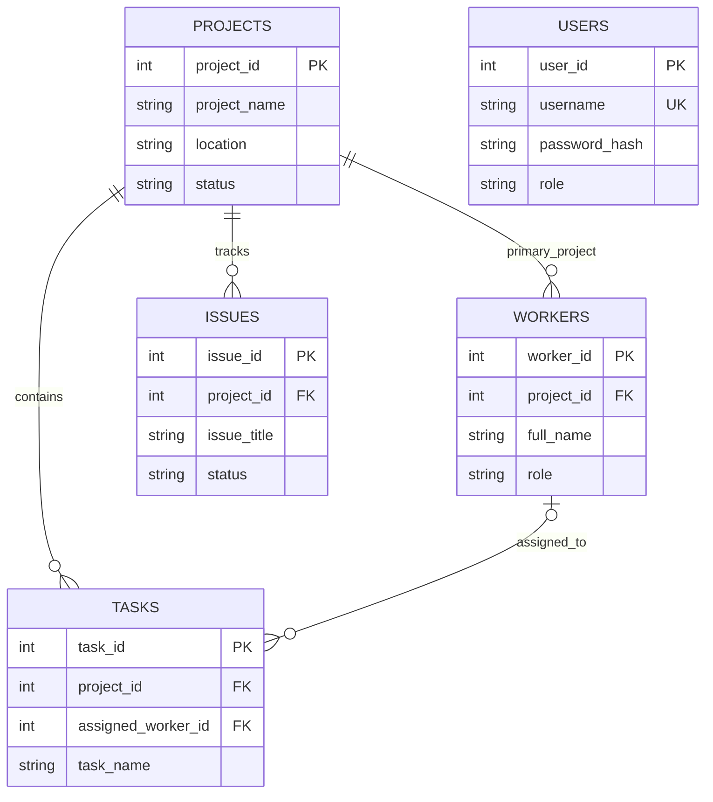

# PropVerse — Build Better. Manage Better.

PropVerse is a small Java Swing desktop construction-site tracker with MySQL persistence. It includes administrator login, a database-backed dashboard, and CRUD screens for projects, tasks, workers, and issues. It uses Java 17+ APIs, JDBC, and no Maven or Gradle.

The CRUD screens use database-populated project and worker selectors, status/availability/priority dropdowns, multi-field search, and module filters. Form validation covers required values, date ordering, nonnegative budgets, progress bounds, contact formats, and task status/progress consistency.

## Prerequisites

- JDK 17 or newer (developed and compiled with Temurin 21).
- MySQL Server 8.0+ (or compatible MySQL server).
- MySQL Connector/J 9.7.0 is included in `lib/mysql-connector-j-9.7.0.jar`. It is the published `com.mysql:mysql-connector-j` driver artifact; the JAR remains a manually configured classpath dependency (no Maven or Gradle build is used). For later versions, use the official MySQL Connector/J download page: https://dev.mysql.com/downloads/connector/j/.

## Database setup

The Java connection and SQL schema both use the database name `propverse_db`. The schema has already been run for the current setup; do not rerun it against a database with existing tables. For a fresh installation, open `database/schema.sql` in MySQL Workbench and execute it.

The application reads `config.properties` from its working directory (normally the project root). Copy `config.properties.example` only for a fresh setup, then set `db.url`, `db.username`, and `db.password`. This local file is ignored by Git and must not be committed.

The optional `database/demo_data.sql` script inserts clearly named example rows and avoids inserting the same sample records again when rerun. Run it manually in Workbench only if you want sample data; it is not executed by the application.

Create the first administrator using **Create first administrator** on the login window. The first account only can be created there; choose a unique username and password of at least 10 characters. Passwords are stored as salted PBKDF2-HMAC-SHA256 hashes using the Java standard library.

## Import and run in Eclipse

1. In Eclipse, use **File → Import → General → Existing Projects into Workspace**, select this project folder, and finish. The project includes `.project`, `.classpath`, and Java 17 compiler settings.
2. Confirm `lib/mysql-connector-j-9.7.0.jar` appears under **Referenced Libraries**. The `.classpath` includes it directly; if Eclipse does not refresh the entry, right-click the project and choose **Refresh**, then **Project → Clean**.
3. Confirm an installed JDK 21 is selected for the JavaSE-21 project runtime. The source/target compiler level is set to Java 17.
4. Confirm `config.properties` exists in the project root and the MySQL server is reachable at the configured URL.
5. Open `src/com/propverse/Main.java`, right-click it, and choose **Run As → Java Application**. The working directory should be the project root so the app can read `config.properties`.

The project has no Maven or Gradle build. To compile and run from PowerShell in the project root:

```powershell
$jars = (Get-ChildItem lib\*.jar | ForEach-Object FullName) -join ';'
$files = Get-ChildItem -Recurse -Filter *.java src | ForEach-Object FullName
javac -cp $jars -d out $files
java -cp "out;$jars" com.propverse.Main
```

## Compile and run

To run the standalone validation checks:

```powershell
$jars = (Get-ChildItem lib\*.jar | ForEach-Object FullName) -join ';'
$files = Get-ChildItem -Recurse -Filter *.java src
javac -cp $jars -d out ($files | ForEach-Object FullName)
javac -cp "out;$jars" -d out test\InputValidatorCheck.java
java -cp "out;$jars" InputValidatorCheck
```

When MySQL is reachable and `config.properties` has valid credentials, compile and run `test\DatabaseCrudIntegrationCheck.java` to perform insert, lookup, update, filter, and delete checks; it also checks that an unknown username is rejected. The DAO test runs inside one transaction and rolls back its test rows.

## Common setup issues

- **Missing config.properties:** copy the example file and fill in all three values.
- **Communications link failure / connection refused:** make sure MySQL is running and the host/port in `db.url` are correct (default port is 3306).
- **Access denied:** check the MySQL username/password and ensure that account has privileges on `propverse_db`.
- **No suitable driver / Connector/J missing:** add the Connector/J JAR to the compile and runtime classpaths.
- **Unknown database/table:** execute `database/schema.sql` before launching the application.
- **Cannot delete referenced project/worker:** reassign or remove dependent tasks/issues/workers first; foreign keys intentionally protect project history.

## Structure

```text
PropVerse/
├── src/com/propverse/{Main.java,model/,dao/,service/,ui/,database/,util/}
├── database/schema.sql
├── database/demo_data.sql
├── lib/                         # place Connector/J here
├── config.properties.example
├── config.properties            # local-only, ignored by Git
├── .classpath / .project        # Eclipse project and JDBC library setup
├── .gitignore
└── README.md
```

## ER diagram



## Notes

Schema initialization is explicit; the application never creates or drops tables at startup. The checked-in schema uses `CREATE DATABASE IF NOT EXISTS` and plain `CREATE TABLE` statements; it does not drop or replace existing data. `config.properties` is local-only and must not be committed. The demo-data script is optional and was not executed during verification.

Verification in the current workspace: all application and test sources compile with `javac --release 17`; `InputValidatorCheck` passes; `DatabaseCrudIntegrationCheck` passed against `propverse_db` and rolled its transaction back. The integration check rejected an unknown username. A successful login using an existing administrator's password was not tested.
